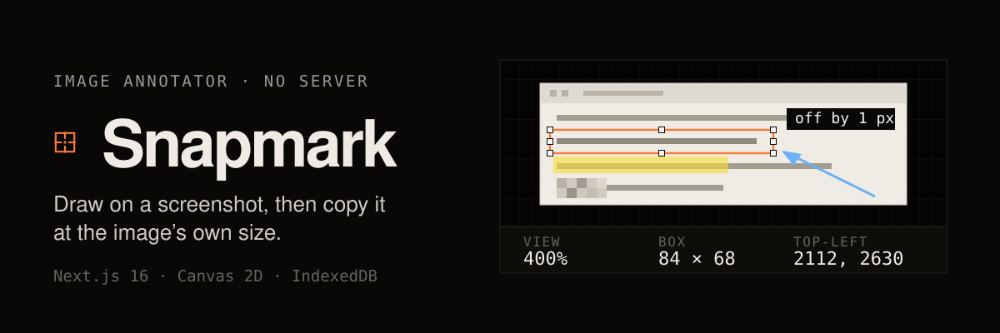
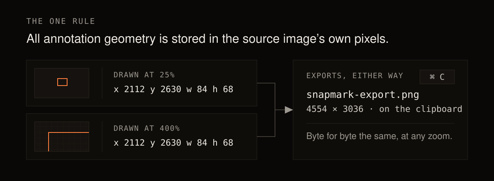
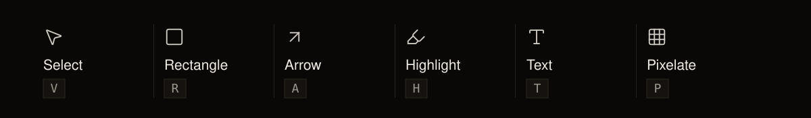

<p align="center">
  
</p>

Open a screenshot or a photo, draw on it, and copy a PNG at the image's own size. Nothing leaves the
browser: no account, no upload, no server.


## What it is

One client-only page. Pick a file, mark it up with six tools, press `⌘C`, and paste: what lands on
the clipboard is the source image at its own size with your marks drawn into it. Each image and its
annotations are filed under the SHA-256 of its bytes in IndexedDB, so opening the same file again
brings its annotations back, whatever it is called.

The design it is built to comes from a Hallmark design file that is not in this repo.

## Every coordinate is an image pixel

<p align="center">
  
</p>

A box drawn at 25% zoom and the same box drawn at 400% export the same bytes, because nothing in the
document model knows the zoom, the viewport size or the device pixel ratio. Geometry is stored in
image space as unrounded floats; affordances — an 8 px handle, a 3 px drag threshold — live in screen
space and are converted at the moment of use. Export is then not a conversion problem: it is the
same scene drawn with the camera set to identity.

## Six tools, one key each

<p align="center">
  
</p>

Select `V` · Rectangle `R` · Arrow `A` · Highlight `H` · Text `T` · Pixelate `P`

The highlighter multiplies, so what is under it stays readable. Text labels sit on a legibility
plate. A pixelate region is recomputed from the original on every draw, so it stays editable rather
than becoming baked pixels. Six fixed colours, no picker — one less decision per mark.

## What else it does

- **Zoom to the pixel.** 10% to 800%, anchored at the pointer, with the image's pixel grid showing
  past 200%. Space-drag, the middle button or two fingers pan.
- **Edit what you drew.** Select one or several, move, resize by eight handles, nudge by a pixel,
  reorder the layers, hide any of them, and undo by operation — one drag, one step.
- **Copy and export.** `⌘C` puts the PNG on the clipboard, or downloads it where the browser has no
  clipboard to offer; the export page also offers a JPEG, or the annotations as W3C Web Annotation
  JSON, which can be dropped back onto the same image. Over a 64 MP budget it scales down and says
  so, rather than handing back a blank file.
- **Dark or light.** The design is dark and that is what you get until you switch, in the app bar;
  the choice is kept. Only the chrome changes — the annotations and their plates are content, so an
  export is the same bytes either way.
- **Reachable by address, keyboard and phone.** Every screen has a URL, every shortcut the panel
  lists works, and the whole loop fits a 375 px viewport by touch.

## Run it

Uses pnpm through corepack (`corepack enable`, or prefix each command with `corepack`).

```sh
pnpm install
pnpm dev      # http://127.0.0.1:3021
```

| Command           | What it does                                                     |
| ----------------- | ---------------------------------------------------------------- |
| `pnpm dev`        | Dev server (`/?debug` shows the render loop's readout)           |
| `pnpm check`      | Format check, typecheck, lint, unit tests, production build      |
| `pnpm test:e2e`   | Builds to `.next-e2e`, then runs the browser checks at 2x and 1x |
| `pnpm test:watch` | Vitest in watch mode                                             |
| `pnpm format`     | Prettier, with Tailwind class sorting                            |
| `pnpm icons`      | Redraws `src/app/apple-icon.png` from `src/app/icon.svg`         |

**Fonts.** Switzer's licence allows self-hosting but not committing the files, so
`scripts/fetch-fonts.mjs` downloads them from Fontshare into `src/assets/fonts/switzer/`
(git-ignored) the first time you run `dev` or `build`, and the app serves them itself. The first run
needs a network connection; `pnpm fonts` fetches them on their own.

## Stack

Next.js 16 (App Router, client-only), React 19, TypeScript, Tailwind CSS 4, shadcn/ui, Lucide icons,
Canvas 2D by hand. Zustand holds the open image and the editor's state, Zod checks data from outside
the app, `idb` keeps the library in IndexedDB. Vitest for units, Playwright for the browser checks.

## The code

The one rule to keep: **all annotation geometry is stored in image pixels**, and only
`src/render/view.ts` knows about device pixels — anything else that folds in the pixel ratio is the
bug that reproduces on a Retina laptop and nowhere else. It is a rule to hold by hand: the grep test
that enforced it was removed when the hero's wordmark (`components/open/tech-text.tsx`, which draws
no annotations) brought its own canvas transform.

The reasoning behind the three coordinate spaces, the stack and the engine limits is in
[`docs/ARCHITECTURE.md`](docs/ARCHITECTURE.md).

<details>
<summary>Where everything lives</summary>

```
src/
  app/                  Next.js: layout, page, globals.css (the design file's tokens),
                        icon.svg (the tab icon; apple-icon.png is drawn from it)
  components/ui/        shadcn primitives
  components/app.tsx    the open page, the editor or the export page, by address (use-session.ts)
  components/session-store.ts  the open image, its history, the tool and selection (Zustand)
  components/open/      the open screen: pick, drop, paste, the figure's lenses and the intro it
                        draws on itself (intro.ts), the library, and the dead ends
  components/export/    the export page
  components/editor/    the editor: app bar, editor bar, canvas stage, inspector, layers
                        (hint.tsx: what a control does, on hover and on focus)
  model/types.ts        ALL geometry is image space: the annotation types
  model/doc.ts          the document: annotations by id, in paint order
  model/palette.ts      the six colours
  model/image.ts        format from bytes, decode upright
  model/sample.ts       the sample photo (public/samples/) and its annotations
  model/persist.ts      IndexedDB: images and documents by the hash of the bytes (hash.ts, stored.ts)
  model/schema.ts       Zod schemas for annotations from outside the app, checked against their types
  export/               render.ts (the image at natural size), clipboard.ts (Copy, or Download),
                        limits.ts (the engines' caps), annotations.ts (the JSON)
  geom/                 matrix.ts (M, toScreen, toImage), camera.ts (fit), arrow.ts, hit.ts,
                        resize.ts, handles.ts
  interact/             machine.ts (press, move, release, preview), draft.ts (what a drag draws)
  history/undo.ts       undo by operation
  render/               view.ts (the only code that knows device pixels), loop.ts, overlay.ts,
                        scene.ts (drawScene, shared with the export), draw/ (per kind)
  lib/                  route.ts (the addresses), store.ts, animate.ts, debounce.ts, text.ts
scripts/                fetch-fonts.mjs, make-fixtures.mjs (the e2e/files images and test chart),
                        make-icons.mjs
e2e/                    Playwright
docs/                   ARCHITECTURE.md, screenshot.webp
assets/readme/          the SVGs on this page
```

Add shadcn components with `pnpm dlx shadcn@latest add <name>`, then `pnpm exec eslint --fix
src/components/ui` to turn their `function` declarations into arrow functions.

</details>

## Credits

The sample photo, `public/samples/lago-di-braies.webp`, is
[“Lago di Braies”](<https://commons.wikimedia.org/wiki/File:Lago_di_Braies_(Unsplash_VowIFDxogG4).jpg>)
by [Luca Bravo](https://unsplash.com/@lucabravo), from Unsplash via Wikimedia Commons,
[CC0](https://creativecommons.org/publicdomain/zero/1.0/), re-encoded as WebP. No credit is
required; see `public/samples/CREDITS.txt`.
